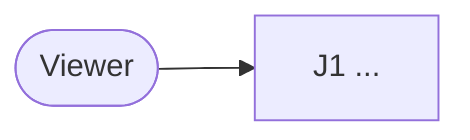
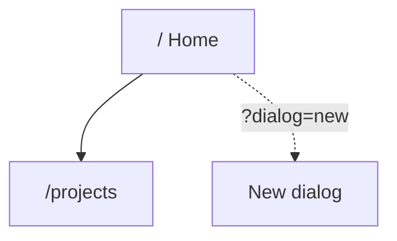
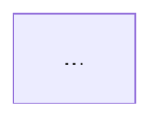
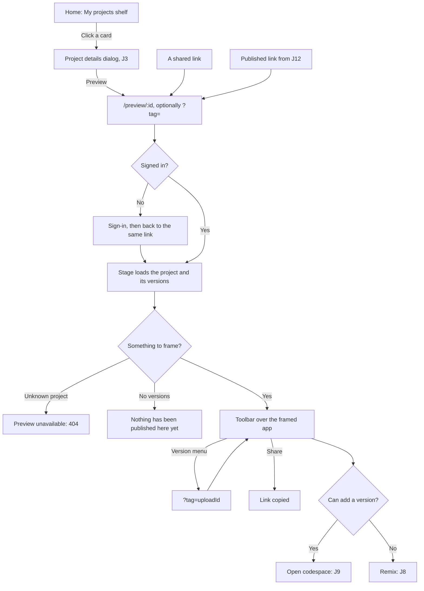

# Document template

The shape of a `USER-FLOWS.md`. Keep the section order; adapt names, actors and
journeys to the product. Write in the language of the project's existing docs.

## Sections

````markdown
# User flows

What a person can do with <Product>, end to end: where they start, what they
press, what opens, and what they end up with. It exists so we can agree which
journeys must never break, and protect exactly those before a release.

<Link to the specification and architecture docs, and say how this one differs:
they say what must be true and how it is built; this says what it looks like
from the outside.>

## Vocabulary

| Term | What it means here |
| --- | --- |
| **User flow** / **journey** | ... |
| **Critical user journey (CUJ)** | ... Marked **P0** below. |
| **Use-case map** | ... |
| **Smoke / regression suite** | ... |
| **Surface** | Where an action is taken: <the product's surfaces>. |

<Link to the product glossary. Note any UI word that differs from the code word
for the same thing, e.g. "Remix" in the UI is "fork" in the code.>

## How this was put together

<What was walked in a running build and how (local server, seeded data,
harness pages); what was read from code only, and why. One line asking that a
change to a journey updates this document in the same pull request.>

## Actors

| Actor | Who they are | Where they act |
| --- | --- | --- |

<Define actors by capability. Link to the permission model.>

## The map



### Site map



## Journeys

| ID | Journey | Actor | Priority |
| --- | --- | --- | --- |
| J1 | [Sign in and land on Home](#j1-sign-in-and-land-on-home) | Visitor | P0 |

**P0** ... **P1** ... **P2** ...

### J1. <Journey named as the user would say it>

**Starts:** <every entry point>. **Ends:** <the outcome the person wanted>.



- <Rules a reader would not guess from the diagram.>

Code: <links to files and symbols>.

## Coverage

| Journey | Covered today | Not covered | Priority |
| --- | --- | --- | --- |

### Where the gaps are

1. <Deployed-environment gap, if any>
2. <Browser gap, if any>
3. <Untested orchestration, if any>

### Suggested layers

| Layer | Runs | Journeys |
| --- | --- | --- |
| Post-deploy smoke | After every staging rollout | ... |
| Local browser E2E | In CI | ... |
| Existing unit and integration | As today | ... |

<The decision that has to come before deployed tests, e.g. a non-interactive
identity that can pass single sign-on.>

## Open questions

<Found while mapping; recorded here, not fixed. Each with what was observed and
where.>
````

## A finished journey, for reference

````markdown
### J6. Open a published project

**Starts:** a project card, a link somebody shared, a version link, or the link
a publish just produced. **Ends:** the prototype running inside the stage.



- The frame loads from a different origin and is sandboxed.

Code: `stage/PreviewStage.tsx`, `stage/Toolbar.tsx`.
````

## Mermaid conventions

- `flowchart TD` for journeys, `flowchart LR` for the actor map.
- Quote every label that contains `/`, `?`, `:`, `(`, `)`, `;`, `#` or `=`:
  `A["/preview/:id?tag="]`.
- Put user actions on edges (`-- "Click a card" -->`) and screens or states in
  nodes. Decisions are `{"Question?"}` with answered edges.
- Use dotted edges (`-.->`) for deep links and retries that are not the main
  path.
- Do not use `end` as a node id; avoid `<`, `>` and raw HTML in labels.
- Reference other journeys as nodes named by id (`J9["Open codespace: J9"]`)
  rather than redrawing them.

## Coverage conventions

- "Covered today" names test files and what their assertions actually protect.
- "Not covered" names the concrete gap a person would hit: "the dialog's
  Delete button", not "UI tests".
- A row with no gap says `—`.
- Count a browser test only if it drives a real browser; count a deployed check
  only if it runs against a deployed environment.
